<div align="center">

## RoboBuilder: Agentic Robot Co-Design with Real-world Video Feedback in the Loop

> Ghadi Nehme<sup>1</sup>, Dahyun Nam<sup>1</sup>, Akshay Govind Srinivasan<sup>1</sup>, Faez Ahmed<sup>1</sup> <br>
> <sup>1</sup>Massachusetts Institute of Technology

[](https://arxiv.org/abs/2611.23855) [](https://ghadinehme.com/robobuilder.github.io/) [](https://huggingface.co/datasets/DeCoDELab/RoboBuilder)

</div>

<table>
<tr><td width="25%" align="center">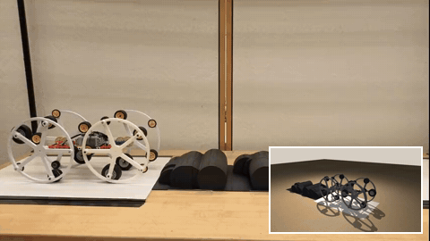<br><sub>Bumps L3 · Opus 5.5</sub></td><td width="25%" align="center">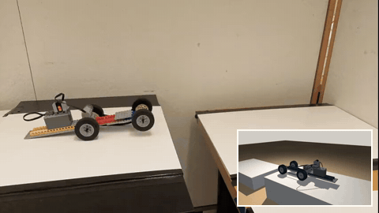<br><sub>Gap-drop L1 · Sonnet 5.5</sub></td><td width="25%" align="center">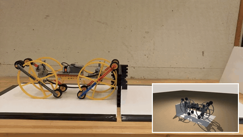<br><sub>Wall L2 · GPT-6 Astra · redesign</sub></td><td width="25%" align="center">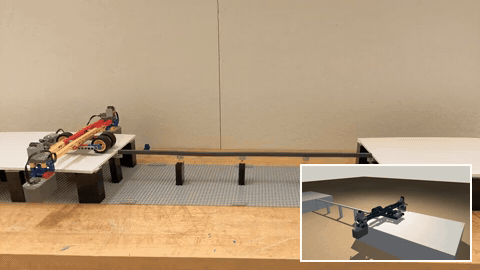<br><sub>Bridge L3 · Opus 5.5</sub></td></tr>
<tr><td width="25%" align="center">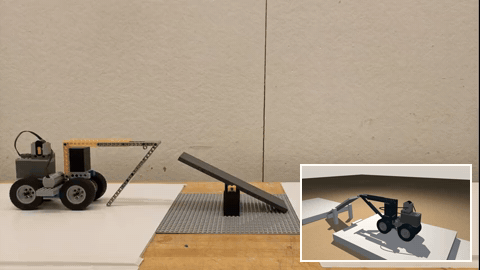<br><sub>Seesaw L2 · GPT-6.1 Sol</sub></td><td width="25%" align="center">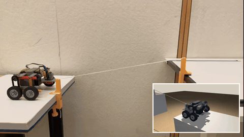<br><sub>Rope L2 · GPT-6 Astra</sub></td><td width="25%" align="center">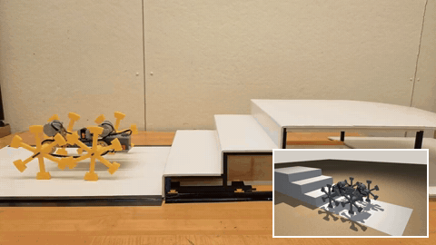<br><sub>Steps L2 · GPT-6.1 Sol · redesign</sub></td><td width="25%" align="center">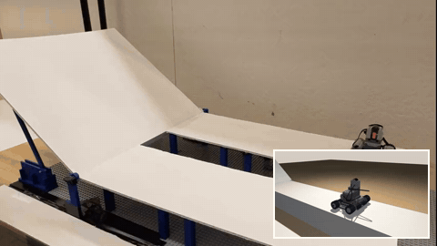<br><sub>U-turn L2 · GPT-6.1 Sol</sub></td></tr>
</table>
<p align="center"><sub>Real runs of agent-designed robots, with their simulation inset.</sub></p>

---

## Introduction

**RoboBuilder** is a benchmark in which coding agents co-design a robot's hardware and its motor program from standard
brick-compatible parts, motors and a custom 3D-printed part, so that it crosses an obstacle course, and every design
that passes in simulation is built and tested on a physical course. A design is a list of placed parts, connections
and a timed, open-loop motor program; a validator checks that it can be built from the owned inventory, and a
simulator learned from real measurements and videos runs it on a twin of the real course.
The initial simulator was built from public data: part geometry and dimensions from the LDraw parts library, part
masses from the BrickLink catalogue, and motor torque–speed curves and tyre friction from Philo's motor measurements
and the Brick Experiment Channel.

Simulation alone is not enough: with that initial simulator, none of 15 robots that passed in simulation crossed the
real course. RoboBuilder therefore combines:

1. **The benchmark.** Ten obstacles (ramp, gap, bridge, rope, steps, bumps, seesaw, gap-drop, wall, U-turn) at three
   levels, four tasks per level (pass, pass with a printed part, lightest, fastest) and an All-in-one task: one robot
   for every obstacle. Agents work in a sandbox with a budget of simulations.
2. **A learned simulator.** A MuJoCo model with breakable stud joints, compliant bearings, slipping gears and chains,
   and a torque–speed motor model, learned by an agent from measurements it requested and videos of real runs.
3. **The real-world loop.** Every simulated pass is built by hand and run on a physical replica of its course; each
   real failure goes back to its agent as a video, and the agent redesigns the robot, correcting its simulator where
   the video shows a modelling error.

This repository holds the benchmark, the learned simulator, the harness and adapters for any coding-agent CLI, the
scoring, the four reference agents' results and designs, and everything for the real-world tests.

---

## Gallery

**Hardware loop.** A robot fails on the real course (left); the agent watches the video and redesigns it (right).

<table>
<tr><th>Real failure</th><th>Redesign</th></tr>
<tr><td width="50%">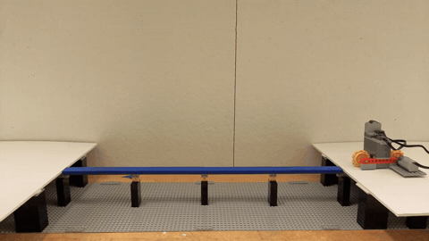</td><td width="50%">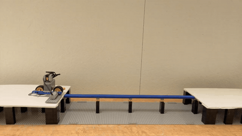</td></tr>
<tr><td width="50%">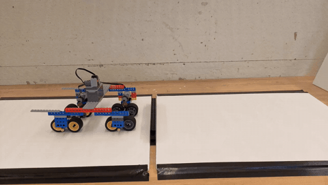</td><td width="50%">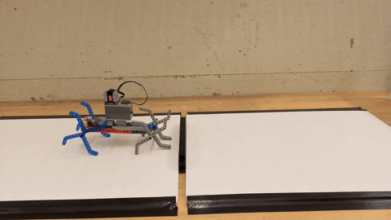</td></tr>
</table>

**Designed robots.** A sample, and all of them grouped by agent.

<p align="center">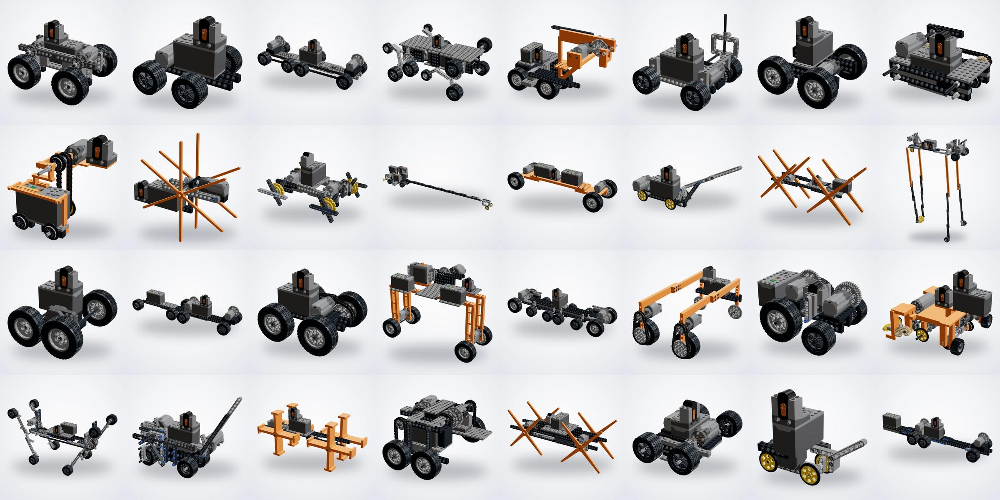</p>
<p align="center">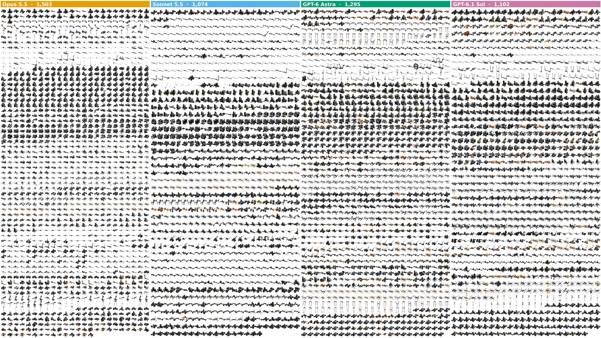</p>

**Built robots.** Agent designs built by hand on their real courses.

<p align="center">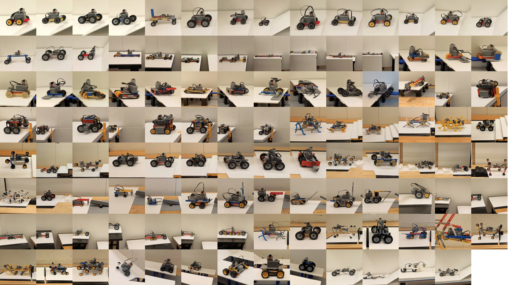</p>

---

## Key Features

- **Functional co-design under constraints.** Hardware and program together, from a fixed inventory of real parts,
  under building rules (owned counts, real joints, meshing gears, at most two chain loops) and a time limit per level.
- **A custom printed part.** When standard parts are not enough, agents write a part as CadQuery code; it is checked
  for printability, simulated, and exported for a real print.
- **Grounded in the real world.** Every simulated pass is built and filmed on a physical course; the courses, printed
  course parts, IR bridge firmware and a browser controller are included.
- **Any coding agent.** Adapters for Claude Code, Codex and Gemini CLI, and a generic adapter for any headless CLI;
  each agent runs in a sandbox without web access and calls one tool.
- **One leaderboard.** `robobuilder score` turns a run into the paper's main table: pass rates per level, with a
  printed part, All-in-one, and Light / Fast scores.

---

## Results

The reference leaderboard (`robobuilder score`), four agents at medium effort. Cross L1/L2/L3: share of the ten tasks
of a level passed; +Print: share of the 30 tasks passed with or without a printed part; All-in-one: share of the ten
courses one robot passes in simulation and on the real courses; Light / Fast: relative scores out of 30; Score: out
of 100.

| Agent | Cross L1 (%) | L2 | L3 | +Print (%) | All-in-one sim (%) | real (%) | Light | Fast | Score |
|---|:---:|:---:|:---:|:---:|:---:|:---:|:---:|:---:|:---:|
| **Opus 5.5** (Claude Code) | **100** | **80** | **40** | **80** | **60** | **60** | **22.6** | **27.1** | **76.4** |
| GPT-6 Astra (Codex) | 90 | **80** | 30 | 77 | **60** | 50 | 18.1 | 10.1 | 57.6 |
| GPT-6.1 Sol (Codex) | **100** | 60 | **40** | 77 | 50 | **60** | 18.5 | 9.6 | 55.1 |
| Sonnet 5.5 (Claude Code) | 90 | 40 | 20 | 53 | 30 | 20 | 17.2 | 11.0 | 44.3 |

In the real world, 73% of level-1 and level-2 simulated passes cross with the learned simulator (66% across all
levels). Shown a video of its real failure, an agent redesigns the robot and removes 72% of the level-1 and level-2
real failures, bringing the real pass rate to 93%. Scoring details are in [docs/benchmark.md](docs/benchmark.md).

---

## Dataset

The data is on Hugging Face: [DeCoDELab/RoboBuilder](https://huggingface.co/datasets/DeCoDELab/RoboBuilder)
(CC BY 4.0). It holds the four agents' 16,427 simulations of 12,774 distinct robots, each with its design, result and
1080p render; the real-world videos of the built robots, each paired with its simulation; and the real-world loop
cases (the failure video, the redesign and its retest).

---

## Code

```bash
git clone https://github.com/ghadinehme/RoboBuilder && cd RoboBuilder
python3.12 -m venv .venv && . .venv/bin/activate
pip install -e ".[test]"
```

Linux, Python 3.12. On Debian / Ubuntu, `python3.12 -m venv` needs the `python3.12-venv` package; without root, use
`uv venv --seed --python /usr/bin/python3.12 .venv`. Running agents also needs `bwrap` (bubblewrap) and the agent CLI.

```bash
robobuilder courses                                                    # the 10 obstacles and their 3 levels
robobuilder task gap 2                                                 # a level as the agent sees it
robobuilder simulate reference_results/designs/opus-5.5/ramp_L1/cross.json ramp 1 --video
robobuilder check reference_results/designs/opus-5.5/ramp_L1/cross.json ramp 1      # the official verdict

robobuilder run --agent claude-code --model claude-opus-5-5 --run-dir runs/opus      # run an agent (or codex, gemini-cli, generic)
robobuilder score runs/opus --name opus                                # its leaderboard row beside the reference agents
```

- [docs/usage.md](docs/usage.md): install details, the command line, running and adding a model, outputs, self-test.
- [docs/benchmark.md](docs/benchmark.md): tasks and budgets, when a design passes, rules, scoring, reference results,
  the simulator.
- [real_world/README.md](real_world/README.md): building the courses, printing, the IR emitter and bridge, running
  and filming a real crossing; [real_world/controller](real_world/controller/README.md) is a browser controller that
  runs designs on the real course, films each try and logs the results.

---

## Citation

If you find our work helpful, please consider citing:

```bibtex
@article{nehme2026robobuilder,
  title   = {RoboBuilder: Agentic Robot Co-Design with Real-world Video Feedback in the Loop},
  author  = {Nehme, Ghadi and Nam, Dahyun and Srinivasan, Akshay Govind and Ahmed, Faez},
  journal = {arXiv preprint arXiv:2611.23855},
  year    = {2026}
}
```

Code: MIT (`LICENSE`). Data (`reference_results/`, `real_world/`, including the STL files): CC BY 4.0
(`LICENSE-DATA`). Parts have brand-neutral names; part numbers are used as identifiers only.

---

## Contact

For questions, issues, or collaboration, please contact: `ghadi@mit.edu`

---
